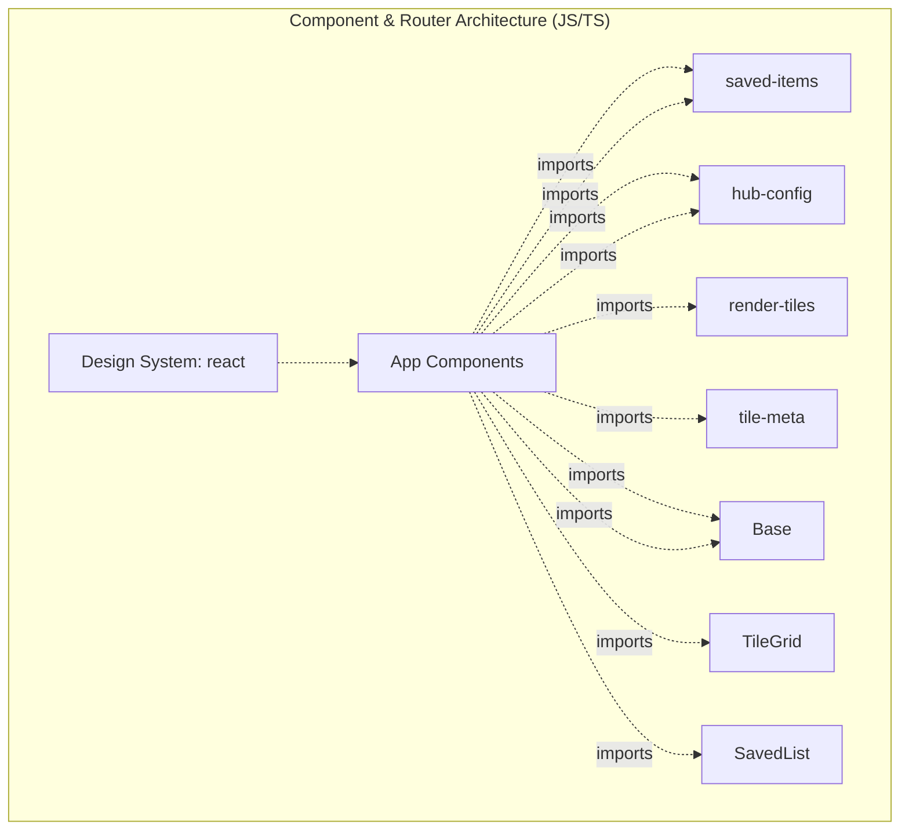

# Codebase Blueprint & Structural Graph

<!-- AUTO:BEGIN — regenerated by sync-architecture.sh. Do not edit. -->
## 1. High-Level Design (HLD) Topology


## 2. Current Target Directory Tree
```text
.
 docs
 public
 scripts
 src
  components
  lib
  pages
```
<!-- AUTO:END -->

## 3. Low-Level Design (LLD) & SOLID Class Schemas
- **Primary Interfaces:**
- **Cross-Service Communication:**
- **Data Inversion Maps:**

_Edit .project-architecture.manual.md; it is preserved across regenerations._
